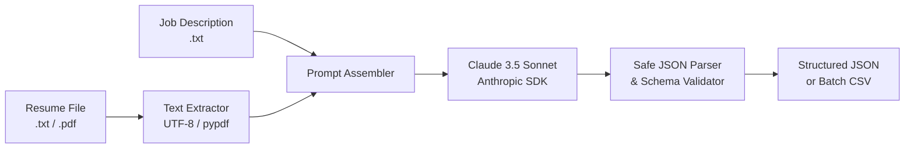

# AI-Resume-Screening-Workflow (Stage 1)

[](https://www.python.org/downloads/)
[](https://docs.anthropic.com/)
[](https://opensource.org/licenses/MIT)

A lightweight, reliable AI-powered candidate evaluation engine built with the official Anthropic Python SDK. It evaluates candidate resumes (`.txt` and `.pdf`) against a target Job Description and outputs validated, structured JSON containing numerical match scores, skill gap analyses, executive summaries, and actionable recommendations.

This repository represents **Stage 1** of an end-to-end autonomous recruitment pipeline designed to later be wrapped in an **n8n** webhook workflow, logging results to Google Sheets and triggering automated candidate communications.

---

## 📌 Problem Statement

Traditional resume screening relies on keyword-matching Applicant Tracking Systems (ATS) that frequently suffer from two critical flaws:
1. **Keyword Overfitting / Gaming**: Candidates stuffing resumes with acronyms get false-positive high scores despite lacking genuine project experience.
2. **Context Blindness**: Qualified candidates using synonymous terminology or highlighting transferrable technical projects are filtered out.

Manual human screening, on the other hand, is time-consuming and subjective when reviewing hundreds of applicants. **AI-Resume-Screening-Workflow** provides a structured programmatic approach: it asks Claude to evaluate demonstrated hands-on technical competencies against job requirements, returning structured JSON that can be ingested downstream.

---

## ⚙️ How It Works

The screening pipeline executes in five sequential steps:



1. **Document Ingestion**: Ingests resume files (`.txt` or `.pdf` via `pypdf`) and target job descriptions.
2. **Context Assembly**: Constructs an objective evaluation prompt defining strict scoring rubrics and requiring raw JSON output.
3. **LLM Evaluation**: Dispatches the payload to Anthropic's Claude using the official SDK (`claude-sonnet-5-5` constant).
4. **Resilient Parsing & Validation**: Strips potential markdown code blocks (` ```json `), parses the raw text via `json.loads()`, and enforces strict schema constraints (validating keys, 0–100 score bounds, and recommendation enums).
5. **Output Routing**: Streams pretty-printed JSON to `stdout` for single files or aggregates evaluations into `results.csv` during batch runs.

---

## 📂 Project Structure

```text
AI-Resume-Screening-Workflow/
├── .env.example              # Template for Anthropic API key
├── .gitignore                # Protects secrets (.env), caches, and results.csv
├── requirements.txt          # Minimal dependencies (anthropic, pypdf, python-dotenv)
├── screen.py                 # Core screening engine, CLI, and batch processor
├── create_sample_pdf.py      # Utility script to generate test PDF resumes
├── test_screen.py            # Complete test suite for parsers, validation, and CLI
├── sample_output.json        # Reference structured evaluation JSON
├── n8n/                      # Stage 2 workflow definition and setup guide
│   ├── README.md             # Node-by-node documentation & curl test commands
│   └── workflow.json         # Importable n8n workflow definition
└── samples/                  # Fictitious sample data for an "AI Intern" role
    ├── job_description.txt
    ├── resume_1_strong_alex_chen.txt
    ├── resume_2_average_jordan_taylor.txt
    ├── resume_3_average_samira_khan.txt
    ├── resume_4_weak_morgan_reed.txt
    └── pdf_test/             # Separate test folder for PDF parsing (avoids batch duplicates)
        └── resume_1_strong_alex_chen.pdf
```

---

## 🚀 Setup & Installation

### 1. Clone & Enter the Repository
```bash
git clone https://github.com/your-username/AI-Resume-Screening-Workflow.git
cd AI-Resume-Screening-Workflow
```

### 2. Set Up a Virtual Environment
```bash
python3 -m venv .venv
source .venv/bin/activate
```

### 3. Install Dependencies
```bash
pip install -r requirements.txt
```

### 4. Configure Your API Key
Set your Anthropic API key in your terminal session (do not hardcode or commit keys):
```bash
export ANTHROPIC_API_KEY="sk-ant-api03-..."
```
*(Alternatively, copy `.env.example` to `.env` and configure it locally — `.env` is tracked in `.gitignore`).*

---

## 💻 Usage Instructions

### Single Resume Evaluation (Live Call)
Run `screen.py` with a resume file and a job description:

```bash
# Evaluate a text resume
python3 screen.py samples/resume_1_strong_alex_chen.txt samples/job_description.txt

# Evaluate a PDF resume
python3 screen.py samples/pdf_test/resume_1_strong_alex_chen.pdf samples/job_description.txt
```

Output is printed as clean, validated JSON directly to `stdout`:
```json
{
  "score": 92,
  "matched_skills": [
    "Python",
    "Anthropic Claude API",
    "n8n workflow automation",
    "REST APIs and Webhooks",
    "JSON data processing",
    "pypdf document parsing",
    "Prompt engineering",
    "Git version control"
  ],
  "missing_skills": [
    "Google Sheets API integration",
    "Airtable direct webhook synchronization"
  ],
  "summary": "Alex Chen demonstrates exceptional alignment with the AI Engineering Intern role, featuring direct hands-on experience building Claude-powered screening pipelines and n8n webhook automations. Their strong background in Python, pypdf, and REST APIs makes them a high-conviction candidate ready to contribute immediately.",
  "recommendation": "shortlist"
}
```

### Batch Evaluation Mode (Live Call)
Process all distinct candidate resumes in the `samples/` folder simultaneously and write consolidated metrics to `results.csv`:

```bash
python3 screen.py --batch samples/ samples/job_description.txt
```

Console output:
```text
[Batch Screening] Found 4 candidate resume(s) in 'samples/'
[Batch Screening] Job Description: 'job_description.txt'
[Batch Screening] Model: claude-sonnet-5-5
----------------------------------------------------------------------
-> Screening: resume_1_strong_alex_chen.txt ... DONE | Score: 92/100 | Rec: SHORTLIST
-> Screening: resume_2_average_jordan_taylor.txt ... DONE | Score: 68/100 | Rec: MAYBE
-> Screening: resume_3_average_samira_khan.txt ... DONE | Score: 68/100 | Rec: MAYBE
-> Screening: resume_4_weak_morgan_reed.txt ... DONE | Score: 18/100 | Rec: REJECT
----------------------------------------------------------------------
[Batch Screening] Successfully processed 4 resumes.
[Batch Screening] Results exported to: /.../results.csv
```
*(Note: `results.csv` is automatically ignored by Git).*

---

### 🧪 Offline / Mock Mode (Testing & Demos Only)

> [!NOTE]
> The `--mock` flag is provided **strictly for offline unit testing, dry runs, and CI/CD validation** without requiring active API keys or burning API tokens. It returns a fixed, deterministic sample evaluation. It is **not** live AI scoring and must not be cited as empirical evaluation results.

```bash
# Test single resume parsing offline:
python3 screen.py --mock samples/resume_1_strong_alex_chen.txt samples/job_description.txt

# Test batch pipeline and CSV generation offline:
python3 screen.py --batch --mock samples/ samples/job_description.txt
```

### Running the Test Suite
Run the automated unit and integration tests:
```bash
python3 -m unittest test_screen.py
```

---

## 📊 Status

- [x] **Stage 1 (Done)**:
  - Python screening engine using official `anthropic` SDK.
  - Model defined as constant `claude-sonnet-5-5` (with `ANTHROPIC_MODEL` override support).
  - Text and PDF resume ingestion with `pypdf`.
  - Resilient JSON parsing with regex fence stripping and schema validation.
  - Granular API error handling (auth, rate limits, network) with user-friendly messages.
  - Single-candidate CLI and folder batch mode exporting to `results.csv`.
  - Automated test suite covering parser edge cases and schema constraints.
- [x] **Stage 2 (Workflow Architecture & Documentation Added)**:
  - n8n workflow template designed (`n8n/workflow.json`).
  - Webhook ingestion supporting both plain text JSON and binary PDF uploads.
  - Native PDF text extraction configured.
  - HTTP Request node configured for Anthropic API with header credential authentication.
  - JavaScript Code node for schema validation, fence stripping, and score boundary checks.
  - Google Sheets node schema mapping (`timestamp`, `candidate_name`, `score`, `recommendation`, `skills`, `summary`).
  - Error Trigger branch configured for pipeline failure audit logging.
  - Detailed setup guide, node specifications, and test `curl` commands in `n8n/README.md`.
- [ ] **Stage 3 (Planned - Live Integration & Email Automations)**:
  - User verification of n8n credentials against live Google Sheets and Anthropic accounts.
  - Automated personalized email draft generation based on `recommendation` and `missing_skills`.
  - Calendar integration for shortlist candidates (Calendly/Google Calendar API).

---

## ⚠️ Limitations & Ethical Considerations

1. **LLM Scoring Variability**: Large language models can exhibit subtle scoring or phrasing variance across runs. Automated scores should serve as an initial triage signal, not an infallible verdict.
2. **Mandatory Human-in-the-Loop**: Automated screening should never execute irreversible hiring rejections without human recruiter oversight. Every "reject" and "maybe" decision must be reviewable by a human to prevent bias.
3. **Format & OCR Constraints**: Scanned resumes containing pure bitmap images without an embedded text layer cannot be parsed by standard text extractors like `pypdf` without OCR pre-processing.
4. **Data Privacy**: Never pass sensitive personally identifiable information (PII) such as social security numbers, passport numbers, or health details into commercial LLM endpoints. All sample resumes in this repository use fictional names and mock data.
