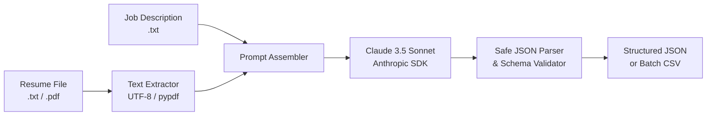

# AI-Resume-Screening-Workflow (Stage 1)

[](https://www.python.org/downloads/)
[](https://docs.anthropic.com/)
[](https://opensource.org/licenses/MIT)

A lightweight, reliable AI-powered candidate evaluation engine built with the official Anthropic Python SDK. It evaluates candidate resumes (`.txt` and `.pdf`) against a target Job Description and outputs validated, structured JSON containing numerical match scores, skill gap analyses, executive summaries, and actionable recommendations.

This repository represents **Stage 1** of an end-to-end autonomous recruitment pipeline that will later be orchestrated via an **n8n** webhook workflow, logging results to Google Sheets and triggering automated candidate communications.

---

## 📌 Problem Statement

Traditional resume screening relies on keyword-matching Applicant Tracking Systems (ATS) that frequently suffer from two critical flaws:
1. **Keyword Overfitting / Gaming**: Candidates stuffing resumes with acronyms get false-positive high scores despite lacking genuine project experience.
2. **Context Blindness**: Qualified candidates using synonymous terminology or highlighting transferrable technical projects are filtered out.

Manual human screening, on the other hand, is time-consuming and subjective when reviewing hundreds of applicants. **AI-Resume-Screening-Workflow** bridges this gap: it uses Claude's contextual comprehension to evaluate demonstrated hands-on technical competencies against job requirements, returning structured JSON that can be ingested programmatically.

---

## ⚙️ How It Works

The screening pipeline executes in five sequential steps:



1. **Document Ingestion**: Ingests resume files (`.txt` or `.pdf` via `pypdf`) and target job descriptions.
2. **Context Assembly**: Constructs an objective evaluation prompt defining strict scoring rubrics and requiring raw JSON output.
3. **LLM Evaluation**: Dispatches the payload to Anthropic's Claude using the official SDK with zero temperature for maximum determinism.
4. **Resilient Parsing & Validation**: Strips potential markdown code blocks (` ```json `), parses the raw text via `json.loads()`, and enforces strict schema constraints (validating keys, 0–100 score bounds, and recommendation enums).
5. **Output Routing**: Streams pretty-printed JSON to `stdout` for single files or aggregates evaluations into `results.csv` during batch runs.

---

## 📂 Project Structure

```text
AI-Resume-Screening-Workflow/
├── .env.example              # Template for Anthropic API key
├── .gitignore                # Protects secrets (.env), caches, and results.csv
├── requirements.txt          # Minimal dependencies (anthropic, pypdf, python-dotenv)
├── screen.py                 # Core screening engine, CLI, and batch processor
├── create_sample_pdf.py      # Utility to generate test PDF resumes
├── test_screen.py            # Complete test suite for parsers, validation, and CLI
├── sample_output.json        # Reference structured evaluation JSON
└── samples/                  # Mock sample data for an "AI Intern" role
    ├── job_description.txt
    ├── resume_1_strong_alex_chen.txt
    ├── resume_1_strong_alex_chen.pdf
    ├── resume_2_average_jordan_taylor.txt
    ├── resume_3_average_samira_khan.txt
    └── resume_4_weak_morgan_reed.txt
```

---

## 🚀 Setup & Installation

### 1. Clone & Enter the Repository
```bash
git clone https://github.com/your-username/AI-Resume-Screening-Workflow.git
cd AI-Resume-Screening-Workflow
```

### 2. Set Up a Virtual Environment
```bash
python3 -m venv .venv
source .venv/bin/activate
```

### 3. Install Dependencies
```bash
pip install -r requirements.txt
```

### 4. Configure Your API Key
Copy the template and insert your Anthropic API key:
```bash
cp .env.example .env
```
Edit `.env`:
```ini
ANTHROPIC_API_KEY=sk-ant-api03-...
```
*(Alternatively, export it directly in your terminal: `export ANTHROPIC_API_KEY="sk-ant-..."`)*

---

## 💻 Usage Instructions

### Single Resume Evaluation
Run `screen.py` with a resume file (`.txt` or `.pdf`) and a job description:

```bash
# Evaluate a text resume
python screen.py samples/resume_1_strong_alex_chen.txt samples/job_description.txt

# Evaluate a PDF resume
python screen.py samples/resume_1_strong_alex_chen.pdf samples/job_description.txt
```

Output is printed as clean, structured JSON to `stdout`:
```json
{
  "score": 92,
  "matched_skills": [
    "Python",
    "Anthropic Claude API",
    "n8n workflow automation",
    "REST APIs and Webhooks",
    "JSON data processing",
    "pypdf document parsing",
    "Prompt engineering",
    "Git version control"
  ],
  "missing_skills": [
    "Google Sheets API integration",
    "Airtable direct webhook synchronization"
  ],
  "summary": "Alex Chen demonstrates exceptional alignment with the AI Engineering Intern role, featuring direct hands-on experience building Claude-powered screening pipelines and n8n webhook automations. Their strong background in Python, pypdf, and REST APIs makes them a high-conviction candidate ready to contribute immediately.",
  "recommendation": "shortlist"
}
```

### Batch Evaluation Mode
Process all resumes in a folder simultaneously and write consolidated metrics to `results.csv`:

```bash
python screen.py --batch samples/ samples/job_description.txt
```

Terminal progress:
```text
[Batch Screening] Found 5 candidate resume(s) in 'samples/'
[Batch Screening] Job Description: 'job_description.txt'
[Batch Screening] Model: claude-sonnet-5-5
----------------------------------------------------------------------
-> Screening: resume_1_strong_alex_chen.pdf ... DONE | Score: 92/100 | Rec: SHORTLIST
-> Screening: resume_1_strong_alex_chen.txt ... DONE | Score: 92/100 | Rec: SHORTLIST
-> Screening: resume_2_average_jordan_taylor.txt ... DONE | Score: 68/100 | Rec: MAYBE
-> Screening: resume_3_average_samira_khan.txt ... DONE | Score: 68/100 | Rec: MAYBE
-> Screening: resume_4_weak_morgan_reed.txt ... DONE | Score: 18/100 | Rec: REJECT
----------------------------------------------------------------------
[Batch Screening] Successfully processed 5 resumes.
[Batch Screening] Results exported to: /.../results.csv
```

### Offline / Mock Mode (Zero Token Testing)
To verify parsing, PDF reading, and batch pipeline mechanics without calling the live Anthropic API:
```bash
python screen.py --mock samples/resume_1_strong_alex_chen.txt samples/job_description.txt
python screen.py --batch --mock samples/ samples/job_description.txt
```

### Running the Test Suite
Run the automated unit and integration tests:
```bash
python -m unittest test_screen.py
```

---

## 📊 Status

- [x] **Stage 1 (Done)**:
  - Python screening engine using official `anthropic` SDK.
  - Configurable model constant (`claude-sonnet-5-5`).
  - Text and PDF resume ingestion with `pypdf`.
  - Resilient JSON parsing with regex fence stripping and schema validation.
  - User-friendly API error handling (auth, rate limits, network).
  - Single-candidate CLI and folder batch mode exporting to `results.csv`.
  - Test suite and mock mode for offline verification.
- [ ] **Stage 2 (Planned - n8n Webhook Workflow)**:
  - Expose screening function as an HTTP webhook endpoint.
  - Build n8n workflow triggered upon form submission or email reception.
- [ ] **Stage 3 (Planned - Logging & Automations)**:
  - Google Sheets API integration for real-time applicant logging.
  - Automated personalized email draft generation based on `recommendation` and `missing_skills`.
  - Calendar integration for shortlist candidates (Calendly/Google Calendar API).

---

## ⚠️ Limitations & Ethical Considerations

1. **LLM Scoring Variability**: While temperature is set to ensure reproducible outputs, large language models can produce slight variances in score or phrasing across subtle prompt modifications. Scores should serve as an initial filter, not an infallible verdict.
2. **Mandatory Human-in-the-Loop**: Automated screening must never execute irreversible hiring rejections without human recruiter oversight. Every "reject" and "maybe" decision should be subject to periodic human review to mitigate bias.
3. **Format & OCR Constraints**: Scanned resumes containing pure images without an embedded text layer cannot be parsed by standard text extractors like `pypdf` without OCR pre-processing.
4. **Data Privacy**: Never pass sensitive personally identifiable information (PII) such as social security numbers, passport numbers, or health details into commercial LLM endpoints.
