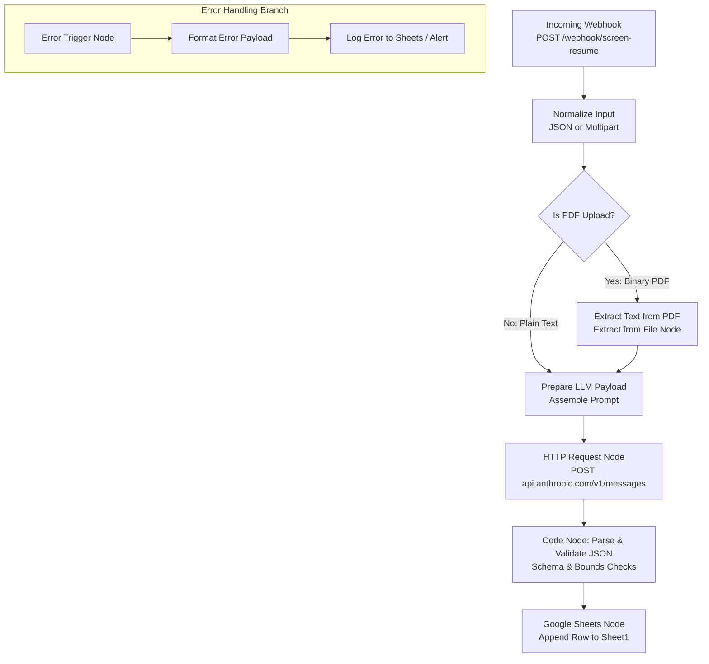

# n8n Workflow: AI Resume Screening Pipeline (Stage 2)

This directory contains the architecture, workflow template, and setup documentation for wrapping the Stage 1 Python screening engine into an automated **n8n** webhook pipeline.

> [!IMPORTANT]
> **Testing Status**: The workflow definition (`workflow.json`) and configuration details below serve as an architectural specification and implementation template. End-to-end functionality requires setting up active credentials (Anthropic API and Google Cloud OAuth) and testing within your local or hosted n8n instance.

---

## 📌 Workflow Overview



The pipeline provides:
1. **Webhook Ingestion**: Accepts candidate applications via HTTP POST containing either raw text or a binary PDF upload.
2. **Text Extraction**: Uses n8n's native file extraction to convert PDF binary streams into plain text.
3. **Anthropic API Integration**: Issues an authenticated HTTP request to Claude (`claude-3-5-sonnet-latest`) using the identical system prompt and schema rubric defined in `screen.py`.
4. **Resilient Parsing & Validation**: JavaScript code node strips code fences, parses JSON, and verifies schema constraints.
5. **Google Sheets Logging**: Appends candidate scores and summaries to a target spreadsheet.
6. **Error Trigger Branch**: Automatically catches pipeline failures (API errors, invalid JSON, missing parameters) and logs them to a dedicated error audit log.

---

## 📂 Directory Structure

```text
n8n/
├── README.md        # Step-by-step setup guide and node reference (this file)
└── workflow.json    # Complete, importable n8n workflow definition
```

---

## 🚀 Step-by-Step Setup Instructions

### 1. Launch n8n Locally
If you do not already have n8n running, launch a local instance using `npx`:

```bash
npx n8n
```
*(By default, n8n will start and be accessible in your browser at `http://localhost:5678`).*

---

### 2. Configure Credentials in n8n

To prevent exposing secret keys in workflow files, credentials are stored in n8n's encrypted vault:

#### Credential A: Anthropic API Key (Header Auth)
1. In n8n, navigate to **Credentials** -> **New Credential**.
2. Select **Header Auth**.
3. Set the fields:
   - **Name**: `Anthropic API Key Header Auth`
   - **Header Name**: `x-api-key`
   - **Header Value**: `sk-ant-api03-...` *(your Anthropic API key)*
4. Click **Save**.

#### Credential B: Google Sheets OAuth2
1. In n8n, navigate to **Credentials** -> **New Credential**.
2. Select **Google Sheets OAuth2 API**.
3. Follow the on-screen prompt to connect your Google account or provide your Google Cloud Console Client ID and Secret.
4. Click **Save**.

---

### 3. Create the Target Google Sheet
1. Open Google Sheets and create a new spreadsheet named: **Candidate Screening Database**.
2. Set up two tabs with the following column headers in Row 1:

#### Tab 1: `Sheet1` (Candidate Evaluations)
| A | B | C | D | E | F | G |
|---|---|---|---|---|---|---|
| `timestamp` | `candidate_name` | `score` | `recommendation` | `matched_skills` | `missing_skills` | `summary` |

#### Tab 2: `Errors` (Failure Log)
| A | B | C | D |
|---|---|---|---|
| `timestamp` | `failed_node` | `error_message` | `execution_id` |

3. Copy the **Spreadsheet ID** from your browser address bar:
   `https://docs.google.com/spreadsheets/d/`**`<YOUR_SPREADSHEET_ID>`**`/edit`

---

### 4. Import the Workflow into n8n
1. Open your n8n workspace (`http://localhost:5678`).
2. Click the three dots `...` in the top-right corner of the canvas and select **Import from File**.
3. Select the file: [n8n/workflow.json](file:///Users/komalkanwar/Desktop/AI-Resume-Screening-Workflow/n8n/workflow.json).
4. Double-click the **Append to Google Sheets** node:
   - Select your configured Google Sheets credential.
   - Replace `YOUR_GOOGLE_SHEET_ID` with your actual spreadsheet ID.
5. Double-click the **Call Anthropic Claude API** node:
   - Verify that your `Anthropic API Key Header Auth` credential is selected.
6. Click **Save** in the top right.

---

## 🔍 Node-by-Node Description

### Node 1: Webhook Ingestion (`Webhook Ingestion`)
* **Type**: `n8n-nodes-base.webhook`
* **HTTP Method**: `POST`
* **Path**: `screen-resume`
* **Response Mode**: `On Received` (immediately returns HTTP 200 to caller while processing asynchronously).
* **Accepted Formats**:
  * JSON body: `{ "candidate_name": "...", "resume_text": "...", "job_description": "..." }`
  * Multipart Form-Data: `candidate_name`, `job_description`, and binary file `resume_file` (PDF).

### Node 2: Input Normalizer & PDF Router (`Normalize Input` + `Is PDF Upload?`)
* **Type**: `n8n-nodes-base.code` + `n8n-nodes-base.if`
* **Purpose**: Inspects incoming payload to verify whether a binary PDF (`item.binary.resume_file`) was uploaded or if raw text was passed in the JSON body.
* **Routing**:
  * **True Branch**: Dispatches binary file to **Extract Text from PDF**.
  * **False Branch**: Routes directly to **Prepare LLM Payload**.

### Node 3: Extract Text from PDF (`Extract Text from PDF`)
* **Type**: `n8n-nodes-base.extractFromFile`
* **Operation**: `Extract from File` -> `text`
* **Binary Property**: `resume_file`
* **Destination Key**: `extracted_pdf_text`
* **Function**: Ingests PDF binary stream and extracts plain UTF-8 text.

### Node 4: Payload Preparation (`Prepare LLM Payload`)
* **Type**: `n8n-nodes-base.code`
* **Purpose**: Merges extracted text, checks that neither resume text nor job description are empty, and constructs the evaluation prompt strictly identical to `screen.py`.

### Node 5: Anthropic Messages API (`Call Anthropic Claude API`)
* **Type**: `n8n-nodes-base.httpRequest`
* **URL**: `https://api.anthropic.com/v1/messages`
* **Method**: `POST`
* **Authentication**: Generic Credential Type -> Header Auth (`x-api-key`)
* **Headers**:
  * `anthropic-version`: `2023-06-01`
  * `content-type`: `application/json`
* **Payload**:
  ```json
  {
    "model": "claude-3-5-sonnet-latest",
    "max_tokens": 1024,
    "system": "You are an automated resume screening engine. You evaluate technical candidates against job descriptions and return raw JSON strictly conforming to the requested schema.",
    "messages": [
      {
        "role": "user",
        "content": "<Generated evaluation prompt>"
      }
    ]
  }
  ```

### Node 6: JSON Parser & Schema Validator (`Parse & Validate JSON`)
* **Type**: `n8n-nodes-base.code`
* **Logic**:
  1. Retrieves raw text from `response.content[0].text`.
  2. Strips markdown fences (`/```(?:json)?\s*([\s\S]*?)\s*```/`).
  3. Executes `JSON.parse()`.
  4. Validates required keys: `score`, `matched_skills`, `missing_skills`, `summary`, `recommendation`.
  5. Enforces `0 <= score <= 100` and recommendation in `['shortlist', 'maybe', 'reject']`.
  6. Formats skills lists into semicolon-delimited strings (`Python; n8n; APIs`) for tabular clarity in spreadsheets.

### Node 7: Google Sheets Logger (`Append to Google Sheets`)
* **Type**: `n8n-nodes-base.googleSheets`
* **Operation**: `appendRow`
* **Sheet**: `Sheet1!A:G`
* **Fields Mapped**:
  * `timestamp` -> `{{ $json.timestamp }}`
  * `candidate_name` -> `{{ $json.candidate_name }}`
  * `score` -> `{{ $json.score }}`
  * `recommendation` -> `{{ $json.recommendation }}`
  * `matched_skills` -> `{{ $json.matched_skills }}`
  * `missing_skills` -> `{{ $json.missing_skills }}`
  * `summary` -> `{{ $json.summary }}`

### Node 8 & 9: Failure Handler (`Error Trigger` + `Format Error Payload` + `Log Error`)
* **Type**: `n8n-nodes-base.errorTrigger`
* **Purpose**: Catches uncaught workflow exceptions (Anthropic network timeouts, invalid JSON, Google Sheets authentication expiry).
* **Action**: Extracts `lastNodeExecuted` and `error.message` and appends an entry to the `Errors` tab of the spreadsheet for administrative triage.

---

## 🧪 Testing with `curl`

Once your workflow is imported and active in n8n, test it using either of the following commands:

### Test 1: JSON Payload with Plain Text Resume
Replace `http://localhost:5678/webhook-test/screen-resume` with your active n8n test webhook URL:

```bash
curl -X POST http://localhost:5678/webhook-test/screen-resume \
  -H "Content-Type: application/json" \
  -d '{
    "candidate_name": "Alex Chen",
    "job_description": "Seeking AI Engineering Intern proficient in Python, Anthropic Claude API, and n8n workflow automation.",
    "resume_text": "Alex Chen. Strong background in Python, Anthropic Claude API prompt engineering, and n8n webhook automations. Experience building candidate screening pipelines."
  }'
```

### Test 2: Multipart Form Upload with a PDF Resume
Test binary PDF extraction by attaching the sample PDF:

```bash
curl -X POST http://localhost:5678/webhook-test/screen-resume \
  -F "candidate_name=Alex Chen" \
  -F "job_description=Seeking AI Engineering Intern proficient in Python, Anthropic Claude API, and n8n workflow automation." \
  -F "resume_file=@../samples/pdf_test/resume_1_strong_alex_chen.pdf;type=application/pdf"
```

---

## 🔒 Security Best Practices

1. **No Hardcoded Keys**: The workflow definition does not contain raw API keys or passwords. Authentication is handled exclusively via n8n's credential store.
2. **Webhook Authentication**: In production, configure Webhook Header Authentication or Basic Authentication on the Webhook node to prevent unauthorized triggers.
3. **Audit Logging**: The Error Trigger branch ensures any upstream API outages or formatting violations are logged without silent data loss.
